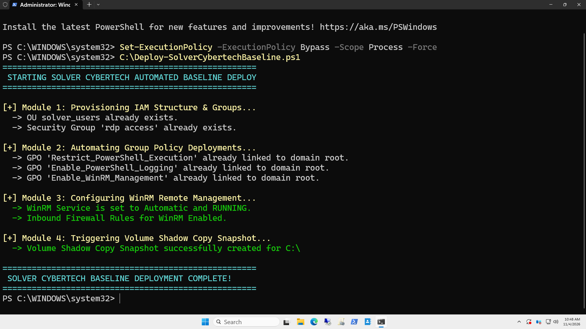
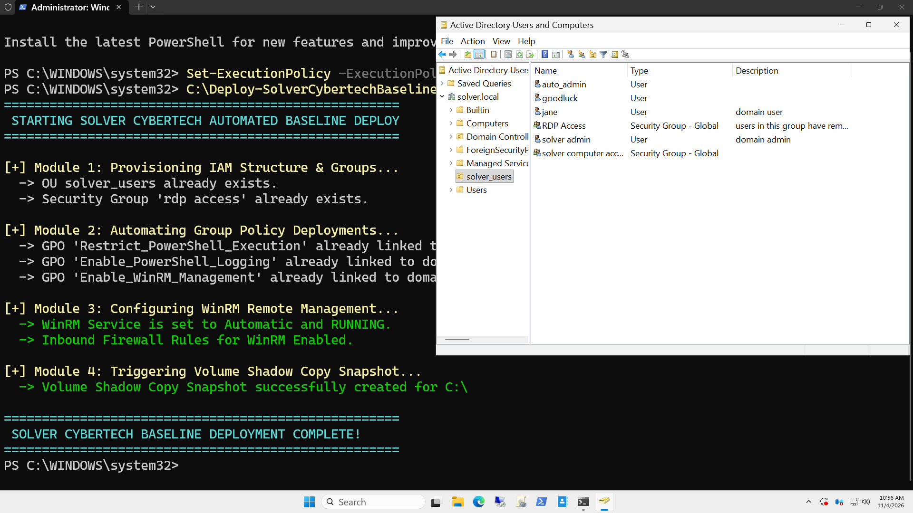
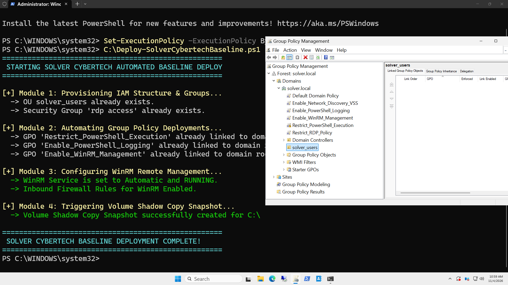
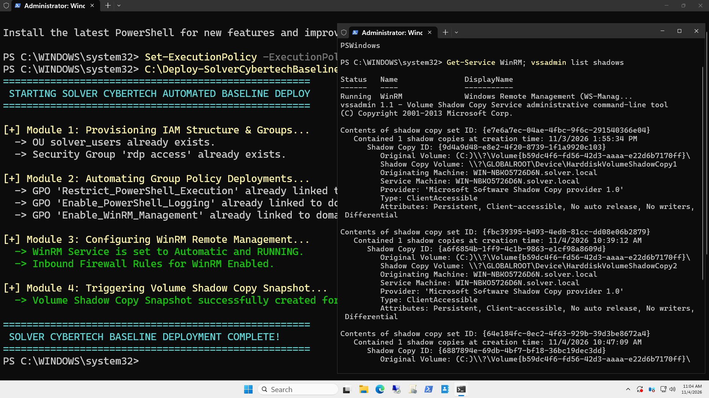

# Active Directory Infrastructure as Code (IaC) & PowerShell Automation

## Executive Summary
This repository contains production-grade PowerShell automation scripts engineered under the **Solver Cybertech** framework. It bridges manual Active Directory administration with automated **Infrastructure as Code (IaC)**, demonstrating how enterprise systems, Identity & Access Management (IAM), Group Policy security baselines, remote management (WinRM), and storage disaster recovery (VSS) can be deployed programmatically at scale.

---

## Technical Architecture & Automation Scope
* **Target Domain:** `solver.local` (Windows Server 2025)
* **Automation Language:** PowerShell 5.1
* **Design Pattern:** Idempotent scripting (`if (-not ...)` safety checks) to prevent duplication or object modification errors.
* **Core Deployment Modules:**
  1. **IAM Provisioning:** Automated Organizational Unit (OU), Security Group, and user creation.
  2. **GPO Automation:** Programmatic creation and domain-root linking of security policies.
  3. **Remote Management (WinRM):** Automated service startup, listener binding, and firewall configuration.
  4. **Disaster Recovery (VSS):** WMI-triggered Volume Shadow Copy snapshot creation.

---

## Execution Screenshots & Proof of Work


*Fig 1: Master script execution output displaying real-time success logs across all 4 deployment modules.*


*Fig 2: Active Directory Users and Computers (`dsa.msc`) showing automatically provisioned `solver_users` OU and `auto_admin` identity.*


*Fig 3: Group Policy Management Console (`gpmc.msc`) showing automated GPO binding at the domain root.*


*Fig 4: Terminal verification confirming WinRM service status as Running and successful VSS snapshot generation.*

---

## Complete Master Deployment Script (`Deploy-SolverCybertechBaseline.ps1`)

Below is the complete, production-ready automation script used to provision this environment:

```powershell
<#
.SYNOPSIS
    Automated Active Directory Baseline & Security Hardening Deployment Script
.DESCRIPTION
    Solver Cybertech Enterprise Framework
    Automates IAM provisioning, GPO registry hardening, VSS snapshot creation, and WinRM activation.
.AUTHOR
    Peter Okonkwo (Solver Cybertech)
#>

[CmdletBinding()]
param()

$ErrorActionPreference = "Stop"

Write-Host "====================================================" -ForegroundColor Cyan
Write-Host " STARTING SOLVER CYBERTECH AUTOMATED BASELINE DEPLOY " -ForegroundColor Cyan
Write-Host "====================================================" -ForegroundColor Cyan

# --------------------------------------------------
# MODULE 1: IAM & Security Group Provisioning
# --------------------------------------------------
Write-Host "`n[+] Module 1: Provisioning IAM Structure & Groups..." -ForegroundColor Yellow

$OUPath = "OU=solver_users,DC=solver,DC=local"

# Create OU if it doesn't exist
if (-not (Get-ADOrganizationalUnit -Filter "Name -eq 'solver_users'")) {
    New-ADOrganizationalUnit -Name "solver_users" -Path "DC=solver,DC=local"
    Write-Host "  -> Created OU: solver_users" -ForegroundColor Green
} else {
    Write-Host "  -> OU solver_users already exists." -ForegroundColor Gray
}

# Create Security Group
if (-not (Get-ADGroup -Filter "Name -eq 'rdp access'")) {
    New-ADGroup -Name "rdp access" -GroupScope Global -Category Security -Path $OUPath
    Write-Host "  -> Created Security Group: rdp access" -ForegroundColor Green
} else {
    Write-Host "  -> Security Group 'rdp access' already exists." -ForegroundColor Gray
}

# Create Automation Test User
$Password = ConvertTo-SecureString "P@ssword1234!" -AsPlainText -Force
if (-not (Get-ADUser -Filter "SamAccountName -eq 'auto_admin'")) {
    New-ADUser -Name "auto_admin" -SamAccountName "auto_admin" -UserPrincipalName "auto_admin@solver.local" `
               -Path $OUPath -AccountPassword$Password -Enabled $true -ChangePasswordAtLogon$false
    Add-ADGroupMember -Identity "rdp access" -Members "auto_admin"
    Write-Host "  -> Created User 'auto_admin' and added to 'rdp access' group." -ForegroundColor Green
}

# --------------------------------------------------
# MODULE 2: Automated GPO Creation & Linking
# --------------------------------------------------
Write-Host "`n[+] Module 2: Automating Group Policy Deployments..." -ForegroundColor Yellow

Import-Module GroupPolicy

$GPOList = @(
    "Restrict_PowerShell_Execution",
    "Enable_PowerShell_Logging",
    "Enable_WinRM_Management"
)

foreach ($GPOName in $GPOList) {
    if (-not (Get-GPO -Name $GPOName -ErrorAction SilentlyContinue)) {
        New-GPO -Name $GPOName | New-GPLink -Target "DC=solver,DC=local" -LinkEnabled Yes
        Write-Host "  -> Provisioned & Linked GPO: $GPOName" -ForegroundColor Green
    } else {
        Write-Host "  -> GPO '$GPOName' already linked to domain root." -ForegroundColor Gray
    }
}

# --------------------------------------------------
# MODULE 3: Enable WinRM & Remote Management
# --------------------------------------------------
Write-Host "`n[+] Module 3: Configuring WinRM Remote Management..." -ForegroundColor Yellow

Enable-PSRemoting -Force -SkipNetworkProfileCheck
Set-Service -Name WinRM -StartupType Automatic
Start-Service -Name WinRM
Write-Host "  -> WinRM Service is set to Automatic and RUNNING." -ForegroundColor Green

# Enable Inbound Firewall Rule for WinRM (Port 5985)
Enable-NetFirewallRule -DisplayGroup "Windows Remote Management"
Write-Host "  -> Inbound Firewall Rules for WinRM Enabled." -ForegroundColor Green

# --------------------------------------------------
# MODULE 4: Volume Shadow Copy (VSS) Automation
# --------------------------------------------------
Write-Host "`n[+] Module 4: Triggering Volume Shadow Copy Snapshot..." -ForegroundColor Yellow

# Create VSS Snapshot on C: Drive
$WmiClass = [WMICLASS]"root\cimv2:Win32_ShadowCopy"
$Result = $WmiClass.Create("C:\", "ClientAccessible")

if ($Result.ReturnValue -eq 0) {
    Write-Host "  -> Volume Shadow Copy Snapshot successfully created for C:\" -ForegroundColor Green
} else {
    Write-Host "  -> VSS Snapshot creation failed with Return Code: $($Result.ReturnValue)" -ForegroundColor Red
}

Write-Host "`n====================================================" -ForegroundColor Cyan
Write-Host " SOLVER CYBERTECH BASELINE DEPLOYMENT COMPLETE!     " -ForegroundColor Cyan
Write-Host "====================================================" -ForegroundColor Cyan


Technical Breakdown & Code Logic
Idempotent Logic (if (-not ...)): Every object creation block uses conditional checks. This ensures the script can run repeatedly without throwing fatal errors or duplicating directory objects.

Error Handling ($ErrorActionPreference = "Stop"): Forces the script to halt immediately if any command encounters a critical failure, ensuring reliable logging and debugging.

WMI/CIM Integration (VSS): Interacts directly with the Win32_ShadowCopy WMI class to programmatically trigger system-accessible volume snapshots without GUI navigation dependencies.

Author
Peter Okonkwo

Lead Engineer @ Solver Cybertech

GitHub: github.com/solver113

LinkedIn: peter-okonkwo-3b6610230
